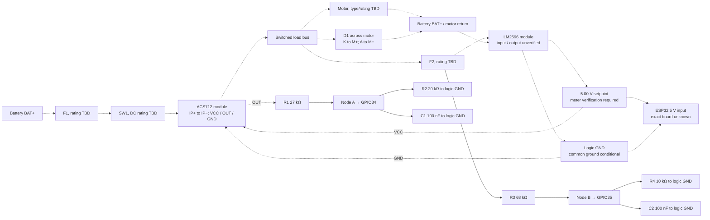

# Independent Engineering Audit — EV Electricity Management System

**Audit date:** 2026-11-02  
**Scope:** electrical reference circuit, component assumptions, wiring and polarity, protection, calculations, the EV simulation, battery/range/cost claims, and the evidence retained in this package.

## Audit disposition

The package contains a **conditional 12 V educational monitoring proposal** and a separate **illustrative 96 V EV simulation**. They are not one electrical system. The current reference has sensible topology and divider arithmetic under stated assumptions, but it is not a build-ready or physically verified assembly. Fuse values, switch and conductor ratings, exact modules, motor ratings, battery limits, transient protection, calibration, and physical pin mappings remain unresolved.

The simulator implements one illustrative vehicle with an aggregate auxiliary-load slider. I found no five-device EV model, no range estimator, and no electricity or fuel-price calculation. Its EV energy arithmetic uses valid identities, but its high-speed full-throttle force and energy behavior is internally inconsistent, and several parameters are assumptions rather than vehicle data.

This is a source-and-calculation audit. I did not energize or physically inspect hardware, reproduce a Wokwi run, or run a test suite. Earlier Wokwi execution is described in the package, but the retained evidence is insufficient to reproduce it. **No physical test or proof is claimed.** The only package addition is this report; the audited originals are preserved.

## Audit basis and revision authority

The latest designated 12 V wiring reference is [ASTRA_3D_WIRING_HANDOFF_FINAL.md](ASTRA_3D_WIRING_HANDOFF_FINAL.md), which names [corrected-wiring-table.csv](corrected-wiring-table.csv) as the conductive-edge authority and explicitly says it is conditional. I used that topology when describing the current proposal. This is a document authority decision, not evidence that any wire or module exists as drawn.

The older [battery-monitoring-wiring-guide.md](../battery-monitoring-reference/battery-monitoring-wiring-guide.md), [battery-monitoring-pinout.csv](../battery-monitoring-reference/battery-monitoring-pinout.csv), schematic, and validation report describe a different proposal: ACS712 in the motor-only branch, no explicit F2 in the connection schedule, 15 kΩ/20 kΩ current attenuation, and 120 kΩ/22 kΩ battery attenuation. Earlier material in hardware-validation/provided-references also contains 62 kΩ or 56 kΩ divider values and a proposed 1–2 A F2. Those revisions conflict with the current 27 kΩ/20 kΩ and 68 kΩ/10 kΩ proposal and with the explicit statement that neither fuse value is approved. Treat them as historical or revise them; do not combine their parts lists.

## Confirmed correct

### C1. Current proposed divider arithmetic, under its stated assumptions

For the current battery-voltage divider, R3 = 68 kΩ and R4 = 10 kΩ:

- Divider ratio: 10/(68+10) = **0.128205**.
- At the assumed 18.0 V input: **2.3077 V nominal**.
- With 1% resistor corners (R3 = 67.32 kΩ, R4 = 10.10 kΩ): **2.3482 V**.
- The 2.45 V characterized upper range used for classic ESP32 ADC at 11 dB is reached at **18.78 V** at that resistor corner.

For the ACS712 output divider, R1 = 27 kΩ and R2 = 20 kΩ:

- Ratio: 20/(27+20) = **0.425532**.
- At 5.00 V ACS712 supply and nominal 2.50 V zero, the ADC node is **1.0638 V at zero current**.
- At the nominal ±30 A endpoints (0.52–4.48 V ACS output using 2.50 V ± 30×0.066 V/A), the node is **0.2213–1.9064 V**.
- Nominal ADC sensitivity is **28.09 mV/A**.
- A conservative bound using ACS OUT ≤ 5.5 V and 1% resistor corners is **2.3674 V** at the ADC node.

The 18 V value is explicitly an assumed design ceiling, not a battery manufacturer’s charge limit or a transient rating. The 2.45 V value is a characterized accuracy range, not a GPIO survival voltage. Espressif documents the classic ESP32 11 dB range as approximately 150–2450 mV and notes chip-to-chip ADC reference variation; use the exact chip documentation and calibrated conversion. [Espressif ESP-IDF ADC guide](https://docs.espressif.com/projects/esp-idf/en/v4.2/esp32/api-reference/peripherals/adc.html)

### C2. Basic power, energy and charge-counting identities

The equations P = V·I, energy in Wh = ∫P dt / 3600 when power is in watts and time is in seconds, and SOC change = −∫I dt/(3600·capacityAh) are dimensionally correct. The EV engine uses these relationships in its current/power calculation, coulomb integration, and signed energy accumulation. This confirms the equations as implemented algebraically; it does not confirm that assumed sensor inputs, a real battery, or the overall vehicle model are accurate.

The current handoff correctly limits Vprotected × Ipath to an approximation of downstream electrical power. Its voltage tap is after the switch, ACS path, F2 and wiring, while current is in the switched discharge path. The product is therefore not exact battery-post power or motor shaft power. A charger connected directly at the battery would bypass the ACS measurement. A current threshold also cannot prove the motor is rotating or distinguish a stall. See “Measurement meanings” in the current handoff.

### C3. Nominal capacity multiplication

- The EV proxy arithmetic is 96 V × 150 Ah = **14,400 Wh = 14.4 kWh**.
- The Amptek AT12-7.6 nominal arithmetic is 12 V × 7.6 Ah = **91.2 Wh**.

These are nominal multiplication results only. They do not establish usable energy, discharge duration, capacity at a particular current or temperature, or vehicle range. Amptek’s product page lists the 12 V / 7.6 Ah model and 2,050 g weight; its linked PDF opens only to a Google Drive loading/sign-in page in this audit, so model-specific charge and discharge limits remain unverified. [Amptek product listing](https://amptek.aukark.co.in/electric-toy-ride-ons/)

### C4. Correct separation and conservative claims in the package

The current handoff correctly labels the 12 V circuit as conditional, keeps the relay unwired, marks F1/F2 ratings TBD, labels the DS18B20 as only proposed, and says the 3D ports are logical rather than physical header positions. The dashboard’s “N/A” battery percentage and energy cost are also appropriate while no capacity estimator or tariff is configured. The 12 V monitoring circuit must not be inferred to support the separate 96 V EV proxy: TI’s LM2596 IC is specified for up to 40 V input, and the divider/sensor proposal is likewise a low-voltage design. [TI LM2596 datasheet](https://www.ti.com/lit/ds/symlink/lm2596.pdf)

## Incorrect — provide correction and evidence

### I1. The older divider values do not meet the stated 18 V / 2.45 V ADC target

In the older wiring guide and pinout, 120 kΩ/22 kΩ gives:

- Ratio 22/(120+22) = **0.154930**.
- At 18 V: **2.7887 V nominal** and **2.8362 V** at the 1% worst corner (118.8 kΩ top, 22.22 kΩ bottom).
- The 2.45 V characterized ADC range is reached at **15.81 V nominal**, or about **15.55 V** at that resistor corner.

Correction: retire or clearly label the 120 kΩ/22 kΩ circuit as superseded. The current 68 kΩ/10 kΩ proposal yields 2.3482 V worst-corner at the assumed 18 V ceiling. Neither divider provides transient or fault protection by itself.

### I2. The older ACS712 scaling exceeds the characterized ADC range at positive full scale

The older 15 kΩ/20 kΩ divider has a ratio of 20/35 = **0.571429**. At 5 V supply, the nominal +30 A ACS output of 4.48 V becomes **2.560 V** at the ADC. The 2.45 V characterized range is crossed at about **+27.1 A** under the nominal 66 mV/A sensitivity. This does not mean the GPIO is immediately damaged at 2.56 V; it means the stated full-current measurement range is outside the cited characterized range and has reduced accuracy.

Correction: use the current 27 kΩ/20 kΩ proposal consistently, conditional on identifying the exact sensor and checking any breakout-board conditioning. Allegro specifies a 4.5–5.5 V supply, approximately VCC/2 zero output, 66 mV/A typical sensitivity for the ±30 A part, and increasing output when current flows from IP+ to IP−. It also expressly says the part is **not intended for automotive applications**. The IC datasheet does not rate an unidentified breakout PCB, terminal, or harness for 30 A. [Allegro ACS712 datasheet](https://www.allegromicro.com/-/media/files/datasheets/acs712-datasheet.pdf)

### I3. The old wiring schedule contradicts its own “fused branch” description and measures only motor current

The older guide’s prose calls the LM2596 supply a “switched, fused branch,” but its schematic and pinout connect the buck directly to the switched bus without F2. Its ACS712 primary path is in series with the motor branch only, so it excludes ESP32/buck current. That topology cannot support a claim that the sensor measures total battery discharge or total system power.

Correction: use the current handoff topology as the sole current proposal: battery positive → F1 → switch → ACS IP+ to IP− → load bus; put F2 at the low-current branch takeoff. State that measured current includes all switched discharge loads passing through ACS and excludes a charger connected directly to the battery. The current schedule remains conditional on correct component identification and ratings.

The older pinout also names a 30 A fuse holder and says a 30 A element may be physically close to the battery, even while warning that 30 A is not approved. Keep the rating unresolved throughout; do not present 30 A as a selected or safe value.

### I4. Two EV harness entries connect incompatible signal types

In ev-vehicle-data.js:

- EV_W10 connects DC-DC LV_OUT_PLUS to VCU CAN_H.
- EV_W11 connects cooling OUT to battery-pack HV_MINUS.

The manifest describes these groups as 12 V auxiliary power and coolant respectively. Those endpoints are incompatible with the named destination ports, even though the viewer flags them as unresolved.

Correction: remove these two conductive-looking routes or leave them explicitly disconnected until the package defines the LV bus/auxiliary-battery terminals and coolant return/loop ports. Do not invent a battery or VCU endpoint to make the drawing appear complete. The current README discloses the mismatch but the manifest still encodes it.

### I5. The simulator’s full-throttle power at its speed cap does not balance road load

Using the code’s own defaults at 50% SOC, flat road, 22 m/s (79.2 km/h), air density 1.225 kg/m³, 720 kg mass, Cd 0.34, frontal area 1.9 m², rolling coefficient 0.012, motor efficiency 0.90, inverter efficiency 0.93 and 180 W auxiliary load:

- Combined motor/inverter efficiency = 0.90×0.93 = **0.837**.
- Drag force = **191.51 N**; rolling force = **84.76 N**; total steady road load = **276.27 N**.
- Wheel power needed to hold 22 m/s on level ground = **6.078 kW**.
- Model-consistent battery demand at that steady speed = 6.078/0.837 + 0.180 = **7.441 kW**, or **93.96 Wh/km**.

But at 50% SOC and full throttle the engine still requests 18 kW mechanical power. Its force at 22 m/s is about 818 N, almost three times the 276 N road load. The simulation clamps speed to 22 m/s without reducing throttle force/power or accounting for where the excess goes. Its electrical draw is about **21.685 kW** (18/0.837 + 0.180), equivalent to **273.81 Wh/km** at the imposed speed.

Dividing the full nominal 14.4 kWh by these two rates gives 153.3 km and 52.6 km respectively; at 50% nominal SOC, 76.6 km and 26.3 km. These are **diagnostic arithmetic only, not range predictions**: the spread exposes the model’s speed-cap inconsistency, and both assume all nominal energy is usable with steady conditions and no reserve. Correction: use a force/power controller that reduces tractive force at the speed limit, then validate consumption over a stated drive cycle before displaying range.

### I6. The README overstates “deterministic” simulation behavior

ev-simulation-engine.js clamps each animation-frame time step to 0.1 s. If a background tab or delayed frame has a larger gap, excess elapsed time is discarded. Therefore results depend on the animation-frame sequence and pausing/background behavior; “deterministic” without qualification is incorrect.

Correction: describe this as an interactive, frame-stepped illustrative simulation, or specify a fixed-step accumulator and its gap-handling policy. No implementation change was made during this audit.

### I7. The documented regeneration percentage is not the code’s effective mechanical-to-pack factor

The engine assumption text says “up to 28% of braking power.” The README gives a symbolic ηgen without defining the numeric value. The code calculates regen efficiency as motorEff × inverterEff × regenFraction = 0.90×0.93×0.28 = **0.23436**, or **23.436%** of mechanical braking power before its 10 kW cap and SOC/speed gates. The 28% parameter is multiplied by the other efficiencies; it is not the final fraction.

Correction: either document the effective 23.436% nominal factor and its gates or redefine the parameter/formula so “28%” has the intended meaning. The 10 kW cap is not a verified battery or motor charge-acceptance rating.

### I8. The petrol emissions factor is below the EPA gasoline baseline

The EV viewer uses 2.31 kg CO₂/L. EPA’s gasoline reference is 8.887 kg CO₂ per US gallon, which converts to **2.3477 kg/L**. At the code’s assumed 7.2 L/100 km, the displayed factor yields **16.632 kg/100 km**, compared with **16.903 kg/100 km** using the EPA factor (about 1.6% higher).

Correction: if this comparison is meant to use the EPA US gasoline reference, use and cite 2.3477 kg/L. If it represents a different market/fuel blend, label and cite that basis instead; do not imply the EPA value is universal. [EPA gasoline CO₂ factor](https://www.epa.gov/energy/greenhouse-gas-equivalencies-calculator-calculations-and-references)

## Requires additional information

### R1. Fuse, switch, conductor, connector and motor protection cannot be selected yet

The current reference correctly leaves F1 and F2 ratings TBD. There is no motor identity, rated/start/stall current, wire gauge/length/insulation/installation, connector/holder rating, switch DC motor-load rating, or available battery fault current. A steady-state current estimate alone cannot choose either fuse. Fuse voltage rating and interrupting capacity must match the circuit and available fault current; the fuse must also protect the weakest conductor/component. [Littelfuse fuse fundamentals](https://www.littelfuse.com/assetdocs/fuse-fundamentals-at-the-heart-of-electrical-systems-fuses-keep-operations-live?assetguid=55d2e833-b53b-467f-a0c2-f15ff2316db3)

The 10.5 V, 5 V/0.60 A, 75%-efficiency buck example recalculates to 5×0.60/(0.75×10.5)+0.010 = **0.391 A** input. It is an assumed electronics budget and does not size F2. At 18 V, the 68 kΩ/10 kΩ divider draws only about **0.231 mA** and dissipates about **4.15 mW total** nominally; 0.25 W resistors are ample for that nominal divider load, but this does not establish fault/surge safety or select the branch fuse.

A motor is an inductive load and can have substantial inrush; relay and switch contact suitability depends on the actual load and DC rating. Omron’s generic relay guidance warns that inrush can exceed contact ratings; its motor ratios are examples, not ratings for this unknown DC motor. [Omron relay inrush FAQ](https://www.ia.omron.com/support/faq/answer/36/faq02165/)

### R2. Protection is incomplete

The current handoff correctly calls reverse-polarity protection and TVS/clamp details unresolved. Neither divider protects ESP32 inputs from a wiring fault, reverse voltage, motor transient, or a powered sensor driving an unpowered MCU. C3 is a proposed 100 nF brush-noise capacitor, not an energy clamp. D1’s cathode-to-motor-positive / anode-to-motor-negative orientation is correct only as a provisional flyback arrangement across a simple unidirectional brushed motor; diode part, current/energy rating, motor type, and reversing behavior are unknown.

Before any final schematic can be treated as a build plan, the actual motor/driver topology and source transients must determine suppression and input protection. Do not infer an automotive-rated design: Allegro says ACS712 is not intended for automotive applications.

### R3. Exact module and board selection remains open

- TI’s LM2596 IC has a 4.5–40 V input envelope and 3 A output rating under specified design conditions. That does **not** establish the rating, thermal behavior, component quality, polarity, grounding, or output stability of the unidentified LM2596 board. [TI LM2596 datasheet](https://www.ti.com/lit/ds/symlink/lm2596.pdf)
- The exact ACS712 suffix and breakout PCB/terminal/output conditioning are unknown.
- The ESP32 is described as classic ESP32, but board/model/header pinout and USB/buck power interaction are unknown. GPIO34/35 are plausible ADC1 inputs on the classic ESP32, not verified physical connector positions.
- OLED supply tolerance, pull-up rail, address, and pin order are unknown. Only a module proven compatible with the selected 3.3 V rail fits the proposal.
- The DS18B20 is proposed, not confirmed present; probe wiring and conversion/CRC behavior have not been checked.
- Relay is unwired, which is appropriate until its module, driver, default state, polarity, isolation, and load-contact rating are known.

### R4. The real battery model and state of charge are not established

The Amptek listing supports nominal 12 V and 7.6 Ah only. The available evidence does not establish charge voltage/current, discharge curve/rate basis, capacity under motor load, internal resistance, usable capacity, temperature/age effects, or short-circuit current. Thus 91.2 Wh is not usable energy, and a loaded voltage or a current threshold is not a validated SoC estimator. The current handoff correctly says a known initial state, battery-specific model, and charge history are required.

The EV proxy’s 96 V × 150 Ah capacity arithmetic is correct, and the tanh function evaluates to 83.76 V at 0%, 96 V at 50%, and 108.24 V at 100%. Those numbers are outputs of an assumed curve, not verified empty/full cell cutoffs. The 0.035 Ω internal resistance, NMC proxy curve, 150 Ah usable capacity, and 10 kW regen acceptance have no cell count, series/parallel design, BMS limits, temperature behavior, or battery datasheet behind them. README also says “24 prismatic cell modules”; if that means 24 individual 3.6 V nominal cells in series, it would be 86.4 V nominal rather than 96 V. If “module” contains multiple cells, the pack mapping is missing. Obtain the actual cell/module specification before presenting these as a battery model.

The 11 kW OBC is a visual label, not a charge model. If 11 kW were DC output at 96 V nominal, ideal pack current would be about **114.6 A** (0.76 C for 150 Ah), before voltage and conversion effects. Pack acceptance and charger output basis are not supplied. The UI’s immediate +25% Charge action is explicitly illustrative; it does not simulate that OBC or a real charging limit.

### R5. Auxiliary loads, five-device assumptions, cost and range need definitions/data

I found one EV manifest, one simulation instance, a fixed 180 W auxiliary load, and one aggregate 0–1500 W slider. I found no five separately named devices, device-specific wattage/duty cycles, simultaneous-load model, or five-vehicle profiles. README’s “five views” is a count of website pages, not a five-device simulation. If five devices are intended, specify each load, whether it is on the 12 V or traction bus, duty cycle, startup peak, and DC-DC conversion boundary before results can be checked. The code defines dcdcEff = 0.88 but does not use it; if 180 W is a 12 V-bus load, battery-side power should include converter losses (180/0.88 = 204.5 W under that assumption). If it is already a traction-pack-side load, state that.

No range estimator is implemented: the code exposes SOC, energy used and distance but no range result. Any range derived by dividing nominal pack energy by an arbitrary simulation segment is unverified. A defensible estimate needs usable energy/reserve plus Wh/km from a named duty cycle and defined environmental/load conditions; DOE notes that EV efficiency and range vary substantially with driving conditions, temperature, speed, acceleration and load. [DOE AFDC — All-Electric Vehicles](https://afdc.energy.gov/vehicles/electric-basics-ev)

The real dashboard correctly displays energy cost as N/A until a tariff is configured. The EV view has no electricity price, charging loss, or INR/kWh input; it also has no petrol price. Therefore this package does not calculate either EV electricity cost or petrol cost. The petrol comparison uses 7.2 L/100 km as an unvalidated fixed comparator. Its 9.1 kWh/L energy factor is between DOE AFDC’s published gasoline/E10 lower-heating-value range (about 8.68–8.99 kWh/L) and higher-heating-value range (about 9.32–9.63 kWh/L), so the heating-value basis must be specified before comparing it with battery energy. [DOE AFDC fuel properties](https://afdc.energy.gov/fuels/properties)

## Unverified — do not assume it is correct

### U1. No five-device EV simulation is present

The five-device premise is not supported by the inspected source. One illustrative EV plus an aggregate auxiliary slider cannot establish per-device consumption or a five-device total. Treat any five-device results as nonexistent until the scenario and inputs are supplied.

### U2. Physical wiring, sensor calibration and real telemetry are unverified

The 3D wires are conditional/logical routes, not verified hardware connections. The current CSV itself marks many component leads conditional or unverified; the actual ESP32, ACS, buck, OLED, battery, motor, fuses, switch, connectors, wire and probe were not identified or measured.

The website accepts numeric voltage, current, power and energyWh fields, but it does not enforce power = voltage×current or energy = ∫power dt. The Wokwi sketch uses sliders and a synthetic calculation, not the physical ACS712, battery, fuse, buck, motor, or wiring. Wokwi itself says its potentiometer does not support full analog simulation and gives the same result even when its supply pins are disconnected, so the supplied slider setup cannot validate the resistor-divider transfer or real ADC accuracy. [Wokwi potentiometer documentation](https://docs.wokwi.com/parts/wokwi-potentiometer) The package reports an incomplete OLED image and does not retain a Wokwi project URL, serial capture, compiled binary, or full screenshot. Its prior simulated result is reported history, not independently reproducible evidence. No physical readings or tests are claimed here.

## Corrected calculation and interpretation summary

| Item | Recalculation | Audit interpretation |
|---|---:|---|
| Current voltage divider, 68 kΩ/10 kΩ | 2.3077 V at 18 V nominal; 2.3482 V at 1% worst corner | Fits the 2.45 V characterized target only under the assumed ≤18 V DC input; not surge protection |
| Legacy voltage divider, 120 kΩ/22 kΩ | 2.7887 V at 18 V nominal; 2.8362 V worst corner | Exceeds the characterized target; replace/mark superseded |
| Current sense divider, 27 kΩ/20 kΩ | 1.0638 V zero; 0.2213–1.9064 V at ±30 A nominal; 2.3674 V with 5.5 V rail bound and resistor corner | Arithmetic fits the target under the stated sensor/rail assumption |
| Legacy sense divider, 15 kΩ/20 kΩ | 2.560 V at +30 A; 2.45 V reached near +27.1 A | Full positive range exceeds characterized ADC range |
| Buck budget example | 0.391 A at 10.5 V for assumed 3 W output, 75% efficiency, plus 10 mA | Correct example only; not an F2 rating |
| EV pack nominal energy | 96×150 = 14,400 Wh | Correct nominal product; not usable capacity |
| 12 V battery nominal energy | 12×7.6 = 91.2 Wh | Correct nominal product; not usable capacity |
| EV regen fraction in code | 0.90×0.93×0.28 = 23.436% | Correct effective nominal multiplier before gates/cap; engine assumption text’s 28% statement is inaccurate |
| Petrol CO₂ comparison | 7.2×2.31 = 16.632 kg/100 km; EPA factor gives 16.903 kg/100 km | Fixed comparator only; identify fuel basis or use cited factor |

## Exact package sections requiring revision or an explicit “historical / superseded” label

1. **Legacy ECS circuit:** battery-monitoring-reference/battery-monitoring-wiring-guide.md — Architecture, B (Motor path and ACS712), E (Battery-voltage divider), and connection-table reference. These contain motor-only current sensing, absent F2 in the drawing, and obsolete resistor values. battery-monitoring-reference/battery-monitoring-pinout.csv — P01–P20, especially P04–P08 and P13–P20. battery-monitoring-reference/battery-monitoring-schematic.svg and .png — same older topology. battery-monitoring-reference/battery-monitoring-validation-report.md — topology/calculations and Wokwi evidence sections; label as historical or reissue consistently.
2. **Conflicting prior correction references:** hardware-validation/provided-references/ECS_INDEPENDENT_AUDIT_REPORT.md, battery-monitoring-pinout_CORRECTED.csv, and ASTRA_3D_WIRING_HANDOFF_VERIFIED.md — identify as superseded by the current 13 October handoff or align values and fuse language. They include 15 kΩ/20 kΩ current scaling, 62 kΩ/10 kΩ or 56 kΩ calculation remnants, and a suggested 1–2 A F2.
3. **Current EV model documentation and math:** README.md, “EV Hardware Twin” and “EV Simulator” sections (24 modules, deterministic label, OCV/empty/full language, regen percentage, fixed petrol factors); ev-simulation-engine.js, OCV comment/curve, force/speed cap, regen factor, time-step policy, energyRemainingWh interpretation; ev-vehicle-data.js, pack assumptions and EV_W10/EV_W11/default parameters; ev-viewer.js, petrol comparison factors and labels. Correct the simulation model/claims before treating its energy/km as engineering output.
4. **Telemetry boundary:** README.md telemetry/model-limit sections and app.js telemetry validation/display path. Document that power/energy are accepted inputs, not cross-checked derived values, until a defined sensor/firmware calculation and sampling/integration method exists. Keep the current dashboard’s N/A cost/SoC labels unless the missing estimator and tariff are actually supplied.
5. **Current hardware reference:** ASTRA_3D_WIRING_HANDOFF_FINAL.md and corrected-wiring-table.csv are substantially clearer and their listed divider arithmetic is correct under stated assumptions. Before converting them from conditional reference to a build plan, resolve R1–R5 above: exact parts/ratings, fuses, motor and battery data, transient/reverse-polarity protection, and physical board pin maps. Do not change the stated 18 V assumption into a manufacturer limit without a battery datasheet.

## Primary sources

- [Allegro ACS712 datasheet](https://www.allegromicro.com/-/media/files/datasheets/acs712-datasheet.pdf) — operating supply, transfer direction/sensitivity, conductor resistance, and not-for-automotive statement.
- [Espressif ESP-IDF ADC guide](https://docs.espressif.com/projects/esp-idf/en/v4.2/esp32/api-reference/peripherals/adc.html) — classic ESP32 ADC channels, attenuation ranges and calibration.
- [Espressif ESP32-WROOM-32 datasheet](https://documentation.espressif.com/esp32-wroom-32_datasheet_en.html) and [ESP32-DevKitC V4 guide](https://docs.espressif.com/projects/esp-dev-kits/en/latest/esp32/esp32-devkitc/user_guide.html) — module/board-specific pin and power context; they do not identify the board used in this package.
- [TI LM2596 datasheet](https://www.ti.com/lit/ds/symlink/lm2596.pdf) — IC input range and conditions on the regulator rating.
- [Amptek 12 V / 7.6 Ah product listing](https://amptek.aukark.co.in/electric-toy-ride-ons/) — product-table values only; linked detailed PDF content was not available to this audit.
- [Littelfuse fuse fundamentals](https://www.littelfuse.com/assetdocs/fuse-fundamentals-at-the-heart-of-electrical-systems-fuses-keep-operations-live?assetguid=55d2e833-b53b-467f-a0c2-f15ff2316db3) — voltage and interrupting-rating selection.
- [Omron relay inrush FAQ](https://www.ia.omron.com/support/faq/answer/36/faq02165/) — load-specific inrush/contact-rating context.
- [US EPA gasoline CO₂ calculation](https://www.epa.gov/energy/greenhouse-gas-equivalencies-calculator-calculations-and-references) — 8.887 kg CO₂ per US gallon reference.
- [DOE AFDC fuel properties](https://afdc.energy.gov/fuels/properties) — gasoline/E10 lower and higher heating-value ranges.
- [DOE AFDC all-electric vehicle basics](https://afdc.energy.gov/vehicles/electric-basics-ev) — driving-condition dependence of EV efficiency and range.
- [Wokwi potentiometer documentation](https://docs.wokwi.com/parts/wokwi-potentiometer) — stated limitation of its analog potentiometer simulation.

## Current 12 V logical topology at a glance

This is a reading aid for the conditional reference, not a physical wiring instruction. Dashed paths depend on identifying and rating the actual parts.

The conceptual split is one switched discharge path through the ACS primary and one separately fused electronics/sense branch. F1/F2, switch, motor, module ports, and ground relationship remain conditional; resistor-divider arithmetic is calculated only for the stated values.

